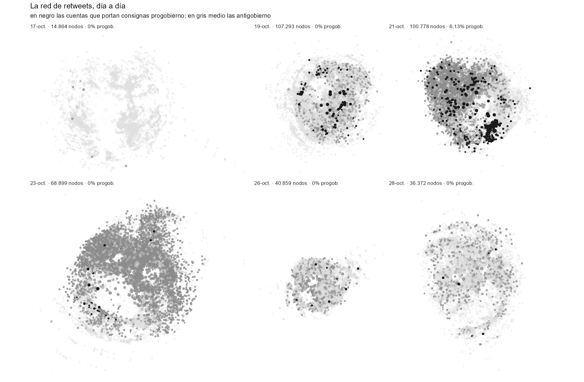

```{r}
#| label: setup
suppressPackageStartupMessages({library(data.table); library(knitr)})
TAB <- "../output/tablas"
leer <- function(f, d = TAB) fread(file.path(d, f), encoding = "UTF-8", na.strings = c("", "NA"))
fmt <- function(x) format(x, big.mark = ".", decimal.mark = ",", scientific = FALSE)
pc  <- function(x, d = 1) paste0(format(round(x, d), decimal.mark = ","), "\\%")

dia  <- leer("global_por_dia.csv"); hora <- leer("global_por_hora.csv")
val  <- leer("validacion_reconstruccion.csv"); cg <- leer("18oct_contagio_comunidades.csv")
cl   <- leer("clases_resumen.csv"); rend <- leer("rendimiento_por_clase.csv")
res  <- leer("18oct_resumen.csv"); pol <- leer("../data/cuentas_politicas.csv", ".")
cons <- leer("../data/externos/consultas_originales.csv", ".")
tot  <- sum(dia$Total); nrt <- sum(dia$Retweet)
ok   <- sum(val$en_originales)
```

# Especificaciones

| | |
|:--|:-----------|
| **Materia** | Ciencias sociales computacionales; comunicación política |
| **Materia específica** | Protesta social, redes sociales digitales, procedencia de datos |
| **Tipo de datos** | Tablas (CSV, Parquet), lista de aristas de red, identificadores de publicaciones |
| **Obtención** | API de búsqueda de Twitter (v1.1) mediante `rtweet`, 49 consultas, recolección diaria |
| **Formato** | Datos derivados, analizados y seudonimizados |
| **Descripción de la recolección** | Recolección diaria durante el evento, del 17 al 29 de octubre de 2019, con una consulta por archivo y consolidación posterior con deduplicación por identificador |
| **Fuente** | Twitter (hoy X), publicaciones públicas |
| **Ubicación** | Chile (cobertura principal); corpus en español (`r pc(92.73, 2)` de las publicaciones) |
| **Accesibilidad** | Código y derivados: `github.com/Alcatruz/estallido-twitter-2019` |
| **Período** | 11 al 29 de octubre de 2019 (19 días) |

: Especificaciones del conjunto de datos {#tbl-spec tbl-colwidths="[22,78]"}

# Valor de los datos {#sec-valor}

- **Registro irreproducible de un evento histórico.** El corpus fue recolectado
  mientras ocurría el mayor ciclo de protesta chileno desde 1990. La API de X
  ya no ofrece acceso retrospectivo a 2019 a ningún precio, de modo que estos
  datos no pueden volver a obtenerse. La evidencia disponible indica además que
  solo un tercio de las publicaciones de conjuntos sensibles sigue siendo
  recuperable [@wu2024mortality], por lo que el corpus preserva material
  eliminado o suspendido con posterioridad.

- **Procedencia documentada, incluida la consulta.** A diferencia de la mayoría
  de los corpus de protesta disponibles, aquí se publica la lista completa de
  las 49 consultas con que se recolectó, recuperada de los archivos originales.
  Esto permite saber qué puede y qué no puede inferirse del material.

- **Un método reutilizable para corpus sin procedencia.** El procedimiento de
  reconstrucción de consultas descrito en la @sec-reconstruccion es aplicable a
  cualquier conjunto recolectado por términos cuya consulta se haya perdido, y
  aquí se reporta su desempeño validado contra la consulta real.

- **Un diagnóstico de contaminación que no existía.** El índice de la
  @sec-contaminacion cuantifica qué fracción de un corpus ingresó por términos
  ambiguos. Dado que los hashtags de fecha son práctica habitual en la
  recolección de datos de protesta, el problema que mide es general.

- **Capas de anotación ausentes en otros corpus del período**: comunidad en la
  red de retweets, clase de cuenta, registro verificado de cargos públicos,
  latencia de amplificación e indicador de contaminación por publicación.

# Antecedentes

El 18 de octubre de 2019, tras semanas de evasiones masivas en el Metro de
Santiago en protesta por el alza de la tarifa, Chile entró en un ciclo de
movilización sin precedentes desde el retorno a la democracia. La conversación
digital asociada fue intensa y breve, y su registro depende de recolecciones
hechas en el momento.

El conjunto que aquí se describe fue recolectado por el autor entre el 17 y el
29 de octubre de 2019, sin un diseño de investigación previo, bajo la
expectativa de que el episodio resultaría relevante. Esa circunstancia —común
en la recolección de datos de crisis— explica que el conjunto careciera
inicialmente de documentación sobre su propia consulta, y motivó el
procedimiento de reconstrucción que constituye el aporte metodológico de este
trabajo.

# Descripción de los datos

## Volumen y composición

```{r}
#| label: tbl-comp
#| tbl-cap: "Composición del corpus por tipo de publicación."
comp <- data.table(
  Tipo = c("Retweets", "Publicaciones originales", "Citas", "Total"),
  n = c(sum(dia$Retweet), sum(dia$Original), sum(dia$Cita), tot))
comp[, `\\%` := c(sprintf("%.2f", 100 * n[1:3] / tot), "100,00")]
comp[, n := fmt(n)]
kable(comp, align = "lrr", booktabs = TRUE)
```

El corpus contiene `r fmt(tot)` publicaciones con identificador único, emitidas
por 701.325 cuentas. La distinción entre publicaciones y textos es relevante
para definir denominadores: solo 764.154 publicaciones (`r pc(100*764154/tot)`)
fueron compuestas por su emisor, y los textos distintos son 755.220. De las
701.325 cuentas, 178.474 escribieron contenido propio; las restantes aparecen
exclusivamente amplificando o siendo amplificadas.

Los análisis de difusión deben usar como denominador las `r fmt(tot)`
publicaciones, pues cada retweet es un evento de propagación. Los análisis de
discurso deben usar los 755.220 textos: de lo contrario, una publicación con
5.000 retweets pondera 5.000 veces.

## Cobertura temporal

{#fig-cobertura width=100%}

El período cubierto va del 11 al 29 de octubre de 2019. El máximo diario no
corresponde al 18 de octubre sino al 19, con 1.096.576 publicaciones. La
proporción de retweets permanece entre `r pc(min(dia$pct_rt))` y
`r pc(max(dia$pct_rt))` durante todo el período, pese a que el volumen diario
varía por un factor superior a 300: la estructura de participación no cambia
con la intensidad del evento.

## Variables

El conjunto derivado incluye, además de los campos estándar de la API,
anotaciones propias: `consulta` (término por el que ingresó cada publicación),
`comunidad_18oct`, `clase_cuenta` (política, medio o ciudadana),
`es_cargo_publico` y `partido`, `latencia_retweet_min` y `solo_hashtag_fecha`
(indicador de contaminación a nivel de publicación).

# Diseño, materiales y métodos

## Recolección

La recolección se realizó con `rtweet` sobre la API de búsqueda de Twitter
v1.1, con una consulta por archivo y ejecución diaria entre el 17 y el 29 de
octubre de 2019. Se preservaron 53 archivos correspondientes a
`r nrow(cons)` consultas distintas, que suman 15.185.311 filas. La
consolidación deduplica por identificador, de lo que resultan 6.714.876
publicaciones únicas, y aplica un filtro temporal adicional que deja el
conjunto final en `r fmt(tot)`.

Las consultas combinan hashtags de consigna (`#ChileDesperto`,
`#EstoPasaEnChile`), de episodio (`#EvasionMasiva`, `#CambiodeGabinete`), de
derechos humanos (`#ChileViolatesHumanRights`), de fecha (`#17oct` a `#22Oct`)
y, en menor medida, palabras sueltas (`INDH`, `congreso`, `Saqueos`).

## Reconstrucción de la consulta {#sec-reconstruccion}

El archivo consolidado no conservaba la columna de consulta. Dado que un corpus
recolectado por términos debe contener al menos uno de ellos en casi toda
publicación, se extraen los hashtags de los `r fmt(tot)` textos y se resuelve
una cobertura glotona: en cada paso se selecciona el hashtag presente en más
publicaciones aún no cubiertas.

{#fig-consulta width=100%}

Cuarenta términos cubren el 91,5% del corpus. La ausencia de un salto marcado
en la ganancia marginal —de 11,2% el primer término a 0,1% el cuadragésimo— es
en sí informativa: indica una lista de rastreo extensa y no un rastreo de dos o
tres etiquetas.

## Validación

La recuperación posterior de los archivos originales permitió contrastar la
reconstrucción contra la consulta efectiva.

```{r}
#| label: tbl-val
#| tbl-cap: "Desempeño de la reconstrucción contra la consulta real."
v <- data.table(
  Indicador = c("Términos reconstruidos",
                "Corresponden a una consulta efectiva",
                "Cobertura del corpus que explican los aciertos",
                "Consultas originales no recuperadas"),
  Valor = c(nrow(val), sprintf("%d (%.0f%%)", ok, 100 * ok / nrow(val)),
            "87,9%", "18 de 49"))
kable(v, align = "lr", booktabs = TRUE)
```

Los tres términos reconstruidos que no corresponden a una consulta son casi
aciertos: el procedimiento identificó `#QueSeVayanLosMilicos` y
`#ChadwickAsesino`, mientras que las consultas fueron `#VayanseMilicos` y la
palabra `chadwick`. En esos casos la reconstrucción describe mejor el contenido
efectivo del corpus que la consulta que lo originó.

La limitación del método es simétrica y cuantificable: de las
`r nrow(cons)` consultas originales, 18 no se recuperan, y corresponden
mayoritariamente a consultas por palabra suelta. Un procedimiento basado en
hashtags es por construcción ciego a ellas.

## Índice de contaminación por consulta ambigua {#sec-contaminacion}

Seis de las consultas son hashtags de fecha y aportan 941.446 publicaciones
(15,4% del corpus). Son términos de uso global: cualquier usuario del mundo
puede emplear `#18Oct` ese día para cualquier asunto.

Para medir el efecto se define, sobre las comunidades de la red de retweets del
18 de octubre, la fracción de publicaciones que contiene un hashtag de fecha
pero ningún término del vocabulario chileno de la consulta.

{#fig-contagio width=100%}

```{r}
#| label: tbl-cont
#| tbl-cap: "Índice de contaminación por comunidad, 18 de octubre de 2019."
e <- c(`8` = "Guardia Nac. Bolivariana (VE)", `2` = "Medios opositores (VE)",
       `1` = "Medios estatales (VE)", `6` = "Mixta", `5` = "Prensa chilena",
       `11` = "Ciudadana (CL)", `10` = "Núcleo político (CL)", `7` = "Fandom K-pop (CL)")
t <- cg[order(-pct_solo_fecha)]
t[, Comunidad := paste0(comunidad, " · ", e[as.character(comunidad)])]
kable(t[, .(Comunidad, Publicaciones = fmt(tweets),
            `Con término chileno` = sprintf("%.1f%%", pct_con_chile),
            `Solo hashtag de fecha` = sprintf("%.1f%%", pct_solo_fecha))],
      align = "lrrr", booktabs = TRUE)
```

La separación es completa: las tres comunidades no chilenas presentan entre
89,9% y 100% de publicaciones ingresadas solo por hashtag de fecha, y las cinco
chilenas entre 0,0% y 0,6%. La comunidad 8 no contiene ninguna publicación con
vocabulario del estallido.

Estas comunidades agrupan 10.828 cuentas y 74.130 retweets, el 19,1% de los
nodos de la red. Su penetración en la conversación chilena, sin embargo, es
marginal: solo el 1,99% de sus retweets alcanza cuentas chilenas, y apenas el
0,42% de los retweets chilenos amplifica cuentas del bloque. Presencia y
influencia difieren en dos órdenes de magnitud, lo que advierte contra inferir
influencia a partir del volumen.

## Estructura de la red y clases de cuenta

Con los retweets del 18 de octubre se construye una red dirigida de 110.736
nodos y 407.387 aristas ponderadas. Tras conservar el núcleo de $k$-core
$\geq 2$ y la componente gigante, la red queda en 56.724 nodos y 354.123
aristas. La detección de comunidades con el algoritmo de Leiden
[@traag2019leiden] arroja 143 comunidades con modularidad 0,505; el 78,6% de
los retweets ocurre dentro de la propia comunidad.

Las cuentas se clasifican en tres clases. La clase *política* procede de un
registro de `r nrow(pol)` cargos en ejercicio en octubre de 2019, construido
por triangulación de las reseñas biográficas de la Biblioteca del Congreso
Nacional, Wikidata y emparejamiento por nombre validado contra la biografía.

{#fig-clases width=100%}

```{r}
#| label: tbl-clases
#| tbl-cap: "Participación de cada clase de cuenta en el corpus."
c2 <- cl[order(-rt_recibidos)]
kable(c2[, .(Clase = clase, Cuentas = fmt(cuentas),
             `\\% cuentas` = sprintf("%.2f", pct_cuentas),
             `\\% publicaciones` = sprintf("%.2f", pct_tweets),
             `\\% retweets` = sprintf("%.2f", pct_rt),
             `RT por cuenta` = fmt(rt_por_cuenta))],
      align = "lrrrrr", booktabs = TRUE)
```

Una cuenta de cargo público recibe en promedio 956 retweets y una ciudadana 6,
una razón de 152 a 1. Sin embargo, la clase política concentra apenas el 2,23%
de la amplificación total: de las quince cuentas más retuiteadas del corpus,
una sola corresponde a un cargo electo. La asimetría se explica por el
rendimiento y no por el volumen: la clase política produce 451 textos únicos en
19 días, cada uno de los cuales circula 265,9 veces, frente a 7,3 de un texto
ciudadano.

## Dinámica de los polos: cuándo desaparece la contraparte {#sec-polos}

La estructura comunitaria permite una pregunta que el corpus responde con
precisión: si existió una contraparte progobierno en la conversación y en qué
momento dejó de existir. Se mide por tres vías independientes.

La primera es léxica. Se definen dos repertorios de consigna a partir de
hashtags verificados en el corpus —progobierno: `#YoApoyoAlPresidente`,
`#CondenamosLaDelincuencia`, `#PazParaChile`; antigobierno: `#RenunciaPiñera`,
`#PiñeraDictador`, `#QueSeVayanLosMilicos`, `#ChileViolatesHumanRights`, entre
otros— y se calculan tasas diarias por 10.000 publicaciones, lo que neutraliza
la enorme variación de volumen entre días. Se excluye del índice
`#ChileSomosTodos`, pese a sus 136.888 apariciones, por haber sido empleado por
ambas partes como consigna de unidad; asignarlo a un polo sería arbitrario.

La segunda es de actores: cuentas del registro de cargos de cada coalición que
aparecen cada día, publicando o siendo amplificadas.

La tercera es estructural. Se reconstruye la red de retweets de cada uno de los
16 días con volumen suficiente, se detectan comunidades y se clasifica cada
comunidad según la composición de polo del contenido que escriben sus
miembros. Se considera progobierno a toda comunidad que emita al menos 30
consignas y en la que más de la mitad correspondan a ese repertorio.

{#fig-polos width=100%}

{#fig-redes width=100%}

```{r}
#| label: tbl-polos
#| tbl-cap: "Presencia estructural del polo progobierno, por día. Las consignas se expresan por cada 10.000 publicaciones; la columna de red, en porcentaje de nodos."
red <- leer("red_por_dia.csv")
p <- leer("polo_por_dia.csv")
t <- merge(red[, .(dia, nodos, modularidad, com_progobierno,
                   nodos_progobierno, pct_progobierno)],
           p[, .(dia, pro_x10mil, anti_x10mil)], by = "dia")
t <- t[dia %in% as.Date(c("2019-10-12","2019-10-17","2019-10-18","2019-10-19",
                          "2019-10-20","2019-10-21","2019-10-23","2019-10-26","2019-10-28"))]
kable(t[, .(Día = format(as.Date(dia), "%d-%b"), `Nodos` = fmt(nodos),
            `Comun. progob.` = com_progobierno,
            `Red progob.` = sprintf("%.2f", pct_progobierno),
            `Consigna progob.` = pro_x10mil, `Consigna antigob.` = anti_x10mil,
            Modularidad = modularidad)],
      align = "lrrrrrr", booktabs = TRUE)
```

El polo progobierno desaparece dos veces. El 12 de octubre, antes del
estallido, constituía el 20,7% de la red y sus consignas superaban a las
opositoras. Entre el 13 y el 19 de octubre deja de existir como estructura:
ninguna comunidad progobierno en siete días consecutivos. Reaparece el 20 y el
21 —durante el estado de emergencia y los saqueos— alcanzando el 18,6% de la
red y su máximo absoluto de consignas, y desde el 22 de octubre no vuelve a
formar comunidad en ningún día.

En el conjunto del corpus las consignas progobierno suman 31.431 publicaciones
(0,51%) frente a 1.405.307 antigobierno (22,96%).

Un resultado colateral merece atención: la modularidad de la red diaria
decrece de forma sostenida, de 0,706 el 17 de octubre a valores entre 0,356 y
0,383 en los últimos días. La red se vuelve *menos* dividida conforme avanza el
ciclo, lo que sugiere un funcionamiento unificador y no polarizante del
episodio, al menos dentro de lo que este corpus captura.

Este resultado debe leerse con una advertencia: la clasificación es léxica y no
ideológica. Una cuenta que cite una consigna progobierno para ridiculizarla
queda contabilizada en ese polo, y con 31.431 publicaciones en total un sesgo
de ese tipo no es despreciable.

# Limitaciones {#sec-limitaciones}

1. **Bordes truncados.** El 11 y el 29 de octubre contienen 168 y 4.203
   publicaciones respectivamente, por el corte de la ventana de recolección.
   Deben excluirse de cualquier serie diaria.

2. **Sesgo hacia el vocabulario inicial.** La lista de consultas se fijó durante
   la primera semana. El 25 de octubre, día de la mayor manifestación del
   ciclo, registra 112.812 publicaciones, menos que la víspera. La consulta
   `#MarchaDelMillon` aporta 48.558 publicaciones frente a las 603.398 de
   `#ChileDesperto`. El corpus subrepresenta sistemáticamente la segunda
   semana.

3. **Contaminación por consulta ambigua.** Cuantificada en la
   @sec-contaminacion. Se recomienda excluir las comunidades 1, 2 y 8 de todo
   análisis sustantivo sobre el estallido.

4. **La clase *medio* es heurística.** A diferencia de la clase política, que
   procede de un registro, se detecta por vocabulario y presenta errores en
   ambas direcciones. Debe usarse como filtro y no como censo.

5. **La clasificación de polos es léxica, no ideológica.** Véase la
   @sec-polos.

6. **Perfil léxico de la clase política no interpretable.** Con 451 textos
   únicos, las medidas de especificidad quedan dominadas por un puñado de
   publicaciones virales.

7. **Cobertura incompleta del padrón.** Se identifican 135 de 156 diputados en
   ejercicio (86,5%) y 6 de 16 ministros.

# Declaración ética

El corpus contiene publicaciones que eran públicas al momento de su emisión. Se
aplica seudonimización diferenciada: las cuentas de cargos públicos conservan su
identificador, por tratarse de actuación pública de figuras públicas y porque su
trazabilidad es condición del valor analítico; las restantes se sustituyen por
un resumen criptográfico estable con sal. La antigüedad de cuenta se publica en
años y el número de seguidores en órdenes de magnitud, pues su combinación
exacta permite la reidentificación.

Se reconoce una tensión irresoluble: el valor archivístico del corpus proviene
de preservar material que ya no existe en la plataforma, y esa misma propiedad
constituye el problema de privacidad, en particular respecto de usuarios que
eliminaron sus cuentas con posterioridad. La distinción por condición de figura
pública administra esa tensión sin eliminarla.

La redistribución se ajusta a las restricciones de la plataforma, que limitan la
difusión de contenido a identificadores [@golland2026access]. Se publican
abiertamente los identificadores y los derivados que no constituyen contenido;
el texto de cuentas ciudadanas queda disponible bajo solicitud.

# Disponibilidad de los datos

Código y datos derivados: `https://github.com/Alcatruz/estallido-twitter-2019`.
Depósito con identificador persistente en preparación.

# Agradecimientos {.unnumbered}

El procesamiento utilizó `data.table` [@dowle2023datatable], `igraph`
[@csardi2006igraph] y `arrow`.
