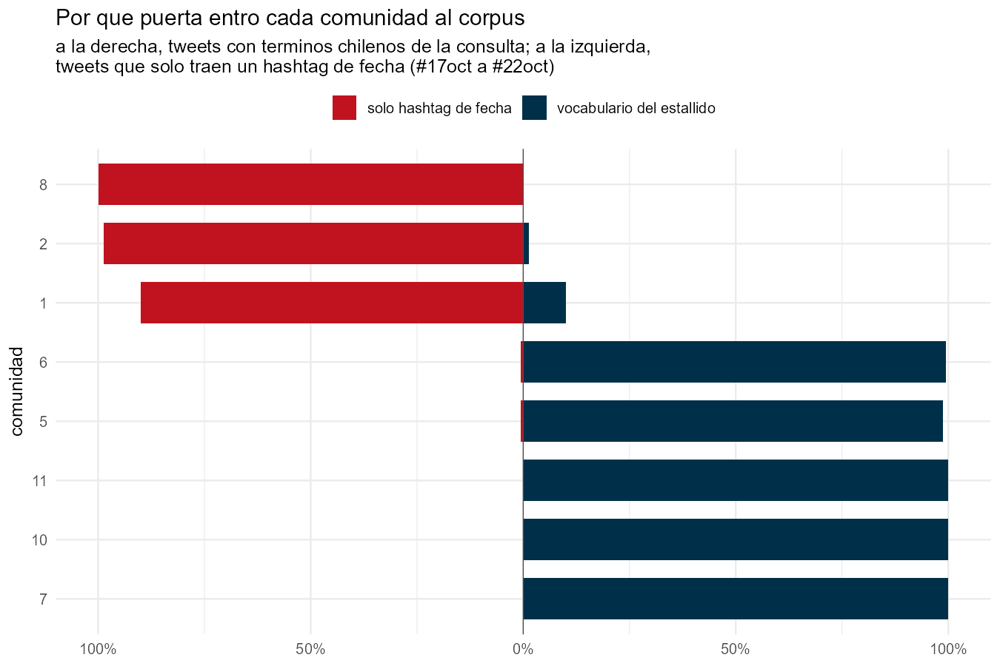

```{r}
#| include: false
source("_comun.R")
cg <- leer("18oct_contagio_comunidades.csv")
```

Seis de las 49 consultas con que se armó el corpus son **hashtags de fecha**:
`#17oct`, `#18Oct`, `#19Oct`, `#20Oct`, `#21Oct`, `#22Oct`. Explican 941.446
tweets, el 15,4% del total. Y son términos que cualquiera en el mundo usa ese
día, hable de lo que hable.

La pregunta es cuánto de este corpus de protesta chilena no habla de protesta
chilena.

## Un índice de contagio

Para cada comunidad se mide qué fracción de sus tweets trae hashtag de fecha
pero **ningún término chileno de la consulta**. Si una comunidad entró por el
vocabulario del estallido, esa fracción es cercana a cero. Si entró por la
puerta genérica, es cercana a uno.

```{r}
#| label: tbl-cont
#| tbl-cap: "Índice de contagio por comunidad, 18 de octubre."
tabla(cg[order(-pct_solo_fecha),
         .(Comunidad = comunidad, Tweets = tweets,
           `% con hashtag de fecha` = pct_con_fecha,
           `% con término chileno` = pct_con_chile,
           `% SOLO fecha` = pct_solo_fecha)], align = "rrrrr")
```



La separación es total. No hay zona gris:

- **Comunidad 8** — Guardia Nacional Bolivariana de Venezuela. **Cero** tweets
  con vocabulario chileno. El 100% entró por hashtag de fecha.
- **Comunidad 2** — medios venezolanos opositores. 98,7%.
- **Comunidad 1** — medios estatales chavistas, incluido teleSUR. 89,9%.
- **Comunidades chilenas** — entre 0,0% y 0,6%.

## Lo que ya se veía en la red

Esas tres comunidades eran justamente las que aparecían **aisladas** en la
[matriz de diálogo](red.qmd): 97%, 97% y 91% de retweets internos. Lo que ahí
se leía como aislamiento estructural, acá tiene una causa concreta: no estaban
en la misma conversación porque nunca entraron a ella.

Sus hashtags lo confirman. La comunidad 1 empuja `#VenezuelaEsDDHH` con 24.047
menciones y tweets que dicen literalmente *"¡LA ETIQUETA DEL DÍA!"*. La
comunidad 2 habla de presos políticos venezolanos y de lluvias en Caracas.

En total son **10.828 cuentas y 74.130 retweets** que conviene excluir antes de
cualquier análisis sustantivo del estallido.

## Presencia no es influencia

El bloque suma el 19,1% de los nodos de la red y el 18,9% del volumen de
retweets. Pero su penetración en la conversación chilena es:

| | |
|---|---|
| Retweets del bloque que llegan a cuentas chilenas | **1,99%** |
| Retweets chilenos que amplifican cuentas del bloque | **0,42%** |

Presencia del 19%, influencia del 0,4%. Es un circuito paralelo que habla solo.

## Por qué esto es generalizable

El método no depende de este corpus. Cualquier dataset recolectado por
hashtags —y los de protesta casi siempre incluyen hashtags de fecha— puede
medir qué fracción de sus datos entró por términos ambiguos. Hasta donde
sabemos, ningún corpus público de Twitter publica ese diagnóstico.
