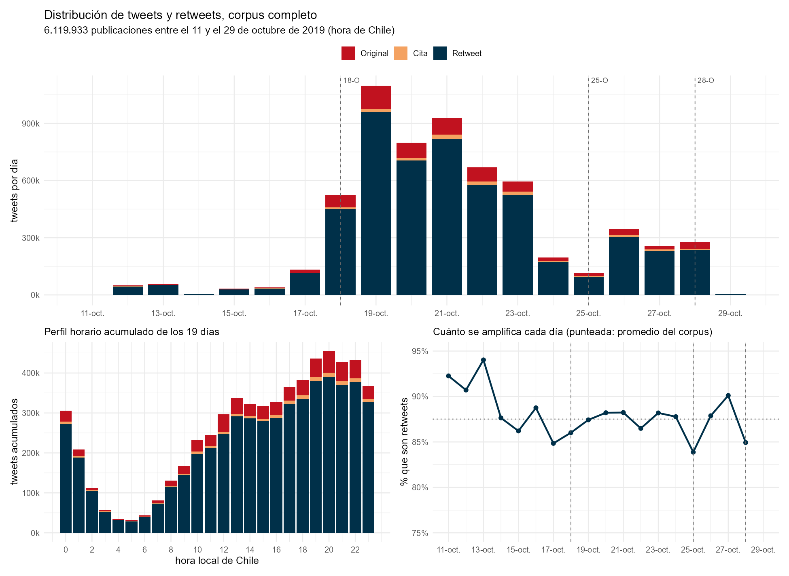

```{r}
#| include: false
source("_comun.R")
dia <- leer("global_por_dia.csv"); hora <- leer("global_por_hora.csv")
tot <- sum(dia$Total); rt <- sum(dia$Retweet)
```

El 18 de octubre de 2019 Chile entró en la mayor crisis social desde el retorno
a la democracia. Estos datos se recolectaron mientras ocurría, día a día, sin
saber en qué iba a terminar. Hoy no se pueden volver a obtener: la API de X ya
no permite ir hacia atrás a octubre de 2019.

::: {.tarjetas}
::: {.tarjeta}
::: {.cifra}
`r fmt(tot)`
:::
::: {.cifra-pie}
tweets
:::
:::
::: {.tarjeta}
::: {.cifra}
701.325
:::
::: {.cifra-pie}
cuentas
:::
:::
::: {.tarjeta}
::: {.cifra}
`r pc(100*rt/tot)`
:::
::: {.cifra-pie}
son retweets
:::
:::
::: {.tarjeta}
::: {.cifra}
19
:::
::: {.cifra-pie}
días, 11 al 29 de octubre
:::
:::
:::

## Seis millones de tweets, 755 mil textos

La cifra grande engaña si se lee mal. De los `r fmt(tot)` tweets, solo
**764.154 fueron compuestos por alguien**; el resto son retweets de esos mismos
textos. Los textos distintos son 755.220.

De las 701.325 cuentas, apenas **178.474 escribieron algo propio**. Tres de
cada cuatro aparecen únicamente amplificando o siendo amplificadas.

La distinción no es cosmética: define el denominador. Para estudiar difusión
—quién amplifica a quién, a qué velocidad— cada retweet es un evento y el
denominador son los 6,1 millones. Para estudiar discurso, el denominador son
los 755.220 textos, o un tweet viral con 5.000 retweets pesaría 5.000 veces.

## Los 19 días



```{r}
#| label: tbl-dias
#| tbl-cap: "Volumen diario por tipo de publicación, hora de Chile."
tabla(dia[, .(Día = format(as.Date(dia), "%a %d-%b"), Original, Cita, Retweet,
              Total, `% RT` = pc(pct_rt, 1))], align = "lrrrrr")
```

El peak no es el 18 de octubre sino el **19**, con 1.096.576 publicaciones, el
doble del 18. La explosión ocurre el viernes por la noche y se descarga el
sábado.

Lo estable es la mezcla: entre 84% y 90% de lo publicado son retweets todos los
días. El volumen sube 300 veces entre el 14 y el 19 de octubre y la proporción
apenas se mueve. La estructura de participación no cambia con la intensidad.

## Dos bordes que no hay que leer como actividad

El 11 y el 29 de octubre están **truncados** por la ventana de descarga: 168 y
4.203 tweets. No son días tranquilos, son días cortados.

Y el 25 de octubre, día de la marcha más grande de Chile, registra 112.812
tweets, menos que el día anterior. Eso no es plausible como actividad real. La
explicación está en [cómo se recolectó](metodo.qmd): la lista de términos se
fijó en la primera semana y para el 25 el vocabulario ya había cambiado.

## Qué hay en este sitio

- [Cómo se recolectó](metodo.qmd) — la consulta original, perdida y reconstruida desde los datos
- [La red del 18-O](red.qmd) — 56.724 cuentas, 143 comunidades
- [Comunidades contagiadas](contagio.qmd) — quiénes entraron por la puerta equivocada
- [La clase política](politicos.qmd) — 171 cargos identificados y su peso real
- [Datos y código](datos.qmd)
