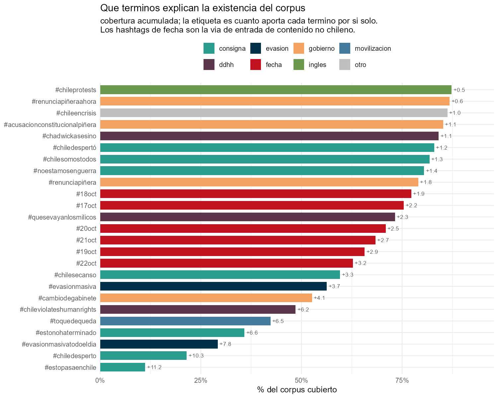

```{r}
#| include: false
source("_comun.R")
cons <- leer("../data/externos/consultas_originales.csv", ".")
val <- leer("validacion_reconstruccion.csv")
```

El corpus se recolectó con el paquete `rtweet` sobre la API de búsqueda de
Twitter, con **una consulta por archivo y ejecución diaria** entre el 17 y el
29 de octubre de 2019. Cada archivo conserva en una columna la consulta que lo
originó.

Se preservaron 53 archivos con `r nrow(cons)` consultas distintas, que suman
15.185.311 filas. Una misma publicación aparece en varios archivos cuando
satisface más de una consulta; al consolidar se deduplica por identificador,
quedando 6.714.876 únicas, y un filtro temporal deja el conjunto final en
6.119.933.

## Las 49 consultas

```{r}
#| label: tbl-cons
#| tbl-cap: "Lista completa de los términos con que se construyó el corpus."
tabla(cons[order(origen, consulta), .(Consulta = consulta, Fuente = origen)])
```

Combinan hashtags de consigna (`#ChileDesperto`, `#EstoPasaEnChile`), de
episodio (`#EvasionMasiva`, `#CambiodeGabinete`), de derechos humanos
(`#ChileViolatesHumanRights`), de fecha (`#17oct` a `#22Oct`) y, en menor
medida, palabras sueltas (`INDH`, `congreso`, `Saqueos`).

## Cuánto aporta cada una



No aportan en partes iguales. `#ChileDesperto` contribuye 658.153
publicaciones y `#HabraConsecuencias`, 61. Diez términos explican más de la
mitad del corpus y la distribución decae de forma continua, sin un corte
natural.

Esto importa para el uso: un análisis restringido a consignas cubre una
porción distinta del corpus que uno que incluya los hashtags de fecha. Y esa
diferencia no es solo de volumen, sino de contenido — es el tema de
[comunidades contagiadas](contagio.qmd).

## Una nota sobre la lista

La lista de términos **se fijó durante los primeros días** del episodio y no se
actualizó. Eso tiene una consecuencia medible: el 25 de octubre, día de la
marcha más grande de Chile, registra 112.812 publicaciones, menos que la
víspera. La consulta `#MarchaDelMillon` aporta 48.558 frente a las 603.398 de
`#ChileDesperto`.

El corpus subrepresenta sistemáticamente la segunda semana del ciclo. No es un
defecto oculto: es una propiedad que cualquier reutilización debe declarar.

## Verificación

Para comprobar que la documentación de consultas está completa se hizo un
contraste independiente: extraer los hashtags de los 6,1 millones de textos y
resolver una cobertura glotona —en cada paso, el hashtag presente en más
publicaciones aún no cubiertas— sin mirar la lista declarada.

De los 40 términos así obtenidos, **`r sum(val$en_originales)` corresponden a
consultas efectivas** y explican el 87,9% del corpus. Los tres restantes son
variantes que la gente usó realmente frente a la forma registrada:
`#QueSeVayanLosMilicos` por `#VayanseMilicos`, `#ChadwickAsesino` por la
palabra `chadwick`.

El contraste no recupera las consultas por palabra suelta, por estar
restringido a hashtags. Confirma la documentación sin sustituirla.
