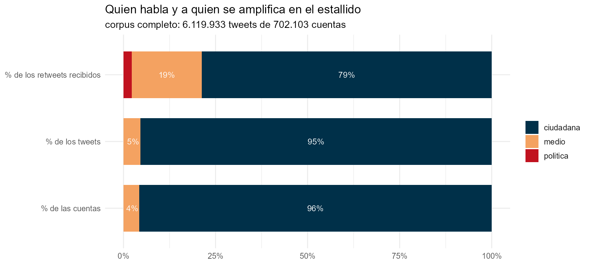

```{r}
#| include: false
source("_comun.R")
cl <- leer("clases_resumen.csv"); rend <- leer("rendimiento_por_clase.csv")
pol <- leer("../data/cuentas_politicas.csv", ".")
dip <- leer("diputados_cuentas.csv")
```

Identificar a los políticos en un corpus de 702.103 cuentas no se hace
adivinando handles. Se parte del padrón real —diputados, senadores, ministros,
Presidente y presidentes de partido en ejercicio en octubre de 2019— y se cruza
contra tres fuentes: las reseñas biográficas de la Biblioteca del Congreso
Nacional, Wikidata, y búsqueda por nombre validada contra la biografía.

```{r}
#| label: tbl-cargo
#| tbl-cap: "Cuentas identificadas por cargo."
g <- pol[, .(Cuentas = .N), by = .(Cargo = cargo)][order(-Cuentas)]
tabla(g)
```

De los 156 diputados en ejercicio durante la ventana del corpus, **135 tienen
cuenta identificada (87%)**, 65 confirmadas por dos fuentes independientes.

## El peso real

```{r}
#| label: tbl-clase
#| tbl-cap: "Las tres clases de cuenta y su participación."
tabla(cl[order(-rt_recibidos),
         .(Clase = clase, Cuentas = cuentas, `% cuentas` = pct_cuentas,
           `% tweets` = pct_tweets, `% retweets` = pct_rt,
           `RT por cuenta` = rt_por_cuenta)], align = "lrrrrr")
```



Dos lecturas que apuntan en direcciones opuestas y las dos son ciertas:

Una cuenta política recibe **956 retweets**, una ciudadana **6**. Es una
ventaja de 152 veces por cuenta.

Pero la clase política concentra apenas el **2,2% de la amplificación total**.
De las 15 cuentas más retuiteadas del corpus completo, **una sola** es de un
cargo electo. El estallido amplificó abrumadoramente a cuentas sin cargo.

## Escriben poco y viaja lejos

```{r}
#| label: tbl-rend
#| tbl-cap: "Textos únicos producidos y circulación obtenida."
tabla(rend[order(-circulacion_por_texto),
           .(Clase = grupo, `Textos únicos` = textos, Circulación = circulacion,
             `Circulación por texto` = circulacion_por_texto)], align = "lrrr")
```

La clase política produce **451 textos únicos** en 19 días y obtiene 119.921
retweets. Un texto suyo circula 36 veces más que uno ciudadano. No amplifica
por volumen sino por rendimiento.

Eso tiene una consecuencia metodológica incómoda: con 451 textos **no se puede
construir un perfil léxico**. La especificidad termina premiando rarezas de dos
o tres tweets virales. Esa medición está calculada en el repositorio pero
marcada como no interpretable.

## Dónde están en la red

Las 125 cuentas políticas presentes el 18 de octubre están **todas dentro de
una sola comunidad**, la 10, donde son el 8,8% de los tweets. Cero en las otras
siete.

## Asimetría por partido

```{r}
#| label: tbl-partido
#| tbl-cap: "Diputados en ejercicio: presencia en el corpus y amplificación."
d <- dip[en_ejercicio_oct2019 == TRUE]
ab <- c("Partido Comunista de Chile"="PC","Revolución Democrática"="RD",
        "Convergencia Social"="CS","Partido Humanista"="PH",
        "Partido Renovación Nacional"="RN","Partido Unión Demócrata Independiente"="UDI",
        "Partido Evolución Política"="Evópoli","Partido Socialista de Chile"="PS",
        "Partido por la Democracia"="PPD","Partido Demócrata Cristiano"="DC")
d[, P := fifelse(partido %in% names(ab), ab[partido], "otros/sin dato")]
t <- d[, .(Diputados = .N, `En el corpus` = sum(presente_corpus),
           RT = sum(rt_recibidos, na.rm = TRUE)), by = P]
t[, `% presentes` := round(100 * `En el corpus` / Diputados)]
t[, `RT por diputado` := round(RT / Diputados)]
tabla(t[Diputados >= 4][order(-`RT por diputado`)], align = "lrrrrr")
```

La lectura fácil sería "la derecha no estaba", pero no se sostiene: RN supera
al PPD, la DC y el PS. Lo que muestran los datos es otra cosa — la
conversación amplificó al PC y al Frente Amplio, y dejó afuera por igual al
gobierno y a la ex-Concertación.

Y hay dos formas distintas de quedar fuera. El PS tiene al 94% de sus
diputados presentes en el corpus pero casi nadie los retuitea: **tuitearon y no
los escucharon**. La UDI tiene al 25%: **directamente no estaban**.
