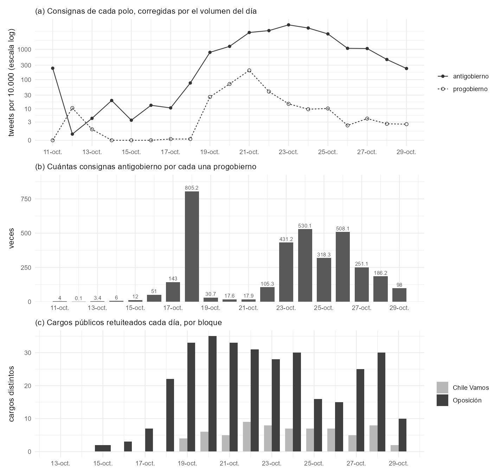

```{r}
#| include: false
source("_comun.R")
pol <- leer("polo_por_dia.csv")[, dia := as.Date(dia)]
red <- leer("red_por_dia.csv")[, dia := as.Date(dia)]
```

Una conversación política tiene normalmente dos polos que se ignoran
mutuamente. En este corpus eso ocurre solo en algunos días, y se puede fechar
con precisión cuándo deja de ocurrir.

La medición usa dos repertorios de consigna verificados en el corpus —
progobierno: `#YoApoyoAlPresidente`, `#CondenamosLaDelincuencia`,
`#PazParaChile`; antigobierno: `#RenunciaPiñera`, `#PiñeraDictador`,
`#QueSeVayanLosMilicos`, `#ChileViolatesHumanRights`— expresados como tasa por
cada 10.000 publicaciones, para neutralizar la enorme variación de volumen
entre días.

## En las consignas

```{r}
#| label: tbl-polos
#| tbl-cap: "Consignas de cada polo por cada 10.000 publicaciones."
tabla(pol[, .(Día = format(dia, "%d-%b"), Total = total,
              `Progob.` = pro_x10mil, `Antigob.` = anti_x10mil,
              `Razón` = razon)], align = "lrrrr")
```



El 12 de octubre, antes del estallido, **las consignas progobierno superaban a
las opositoras**. El 17 y el 18 desaparecen, con razones de 143 a 1 y 805 a 1.
Reaparecen el 19 al 21 —la contramovilización tras los saqueos y el estado de
emergencia— y el 21 alcanzan su máximo absoluto, 201,8 por diez mil. Desde el
22 se derrumban: 431 a 1 el día 23, 508 a 1 el día 26.

En el conjunto del corpus son 31.431 publicaciones progobierno (0,51%) frente a
1.405.307 antigobierno (22,96%).

## En la estructura de la red

Más decisivo que el conteo es si el polo existe como **comunidad**. Se
reconstruyó la red de retweets de cada uno de los 16 días con volumen
suficiente y se clasificó cada comunidad por la composición de polo del
contenido que escriben sus miembros.

```{r}
#| label: tbl-red
#| tbl-cap: "Presencia estructural del polo progobierno, por día."
tabla(red[, .(Día = format(dia, "%d-%b"), Nodos = nodos,
              Comunidades = comunidades,
              `Comun. progob.` = com_progobierno,
              `% de la red` = pct_progobierno,
              Modularidad = modularidad)], align = "lrrrrr")
```


Una comunidad progobierno aparece en **exactamente tres días**: el 12 de
octubre (20,7% de la red), el 20 (18,6%) y el 21 (6,1%). Cero en los otros
trece.

En las láminas se ve directo. El 17 y el 19 no hay un solo punto negro con
estructura. El 21 hay un cúmulo denso abajo a la derecha, una comunidad
reconocible. Del 23 en adelante quedan puntos negros sueltos, dispersos, sin
agruparse en ninguna parte.

## Desapareció dos veces

Esa es la forma del fenómeno, y es más interesante que una sola fecha. El polo
se evapora cuando estalla la crisis (13 al 19 de octubre), **vuelve** durante
el estado de emergencia, y se extingue definitivamente desde el 22.

## Un hallazgo que no buscábamos

La **modularidad cae sostenidamente**: 0,706 el 17 de octubre, 0,504 el 18, y
entre 0,356 y 0,383 los últimos días. La red se vuelve *menos* dividida a
medida que avanza el estallido.

Es lo contrario de lo que uno esperaría de una crisis política, y sugiere que
el episodio funcionó como evento unificador y no polarizante — al menos dentro
de lo que este corpus captura.

## Una advertencia

El indicador es **léxico, no ideológico**. Clasifica cuentas por las consignas
que usan, no por su posición: alguien que cite `#YoApoyoAlPresidente` para
burlarse queda contado en ese polo. Con 31.431 publicaciones en total, un sesgo
así no es despreciable.
