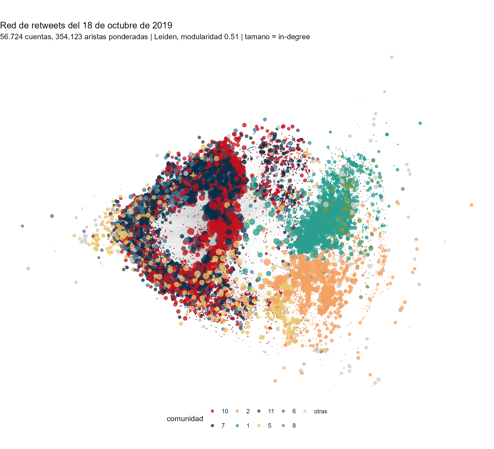
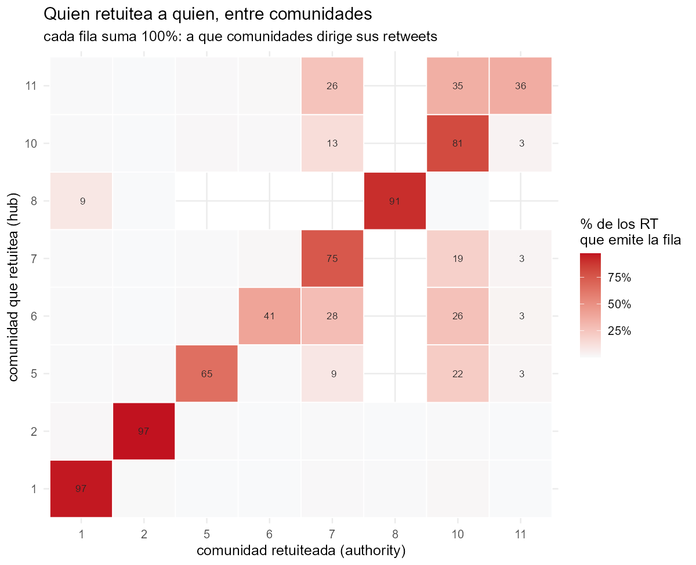
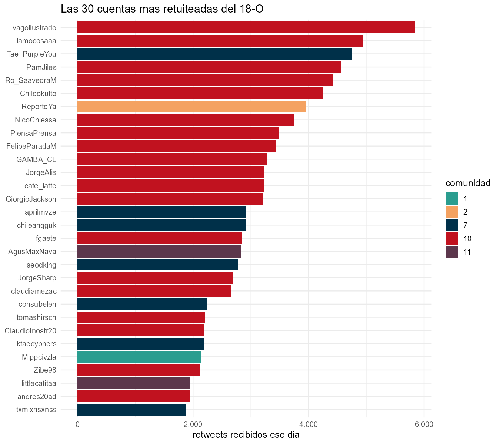
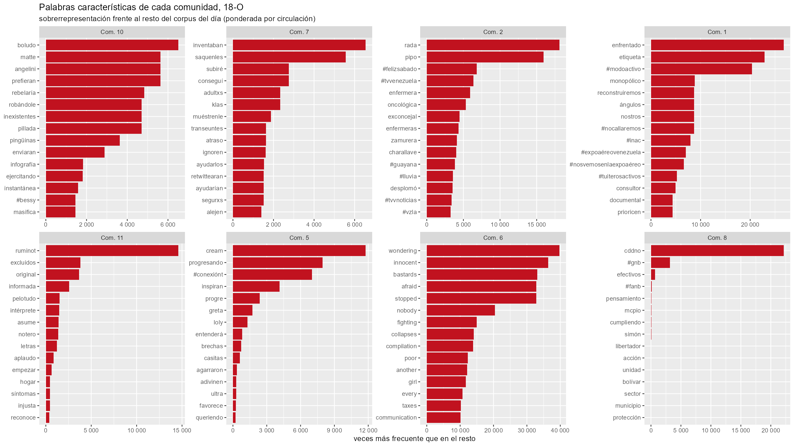

```{r}
#| include: false
source("_comun.R")
perf <- leer("18oct_perfil_comunidades.csv")
lat <- leer("18oct_latencia_por_comunidad.csv")
res <- leer("18oct_resumen.csv")
```

El 18 de octubre concentra **524.528 tweets**, el 8,6% del corpus en 1 de 19
días. Con los retweets de ese día se construye una red dirigida: quien retuitea
apunta a quien es retuiteado.

::: {.tarjetas}
::: {.tarjeta}
::: {.cifra}
110.736
:::
::: {.cifra-pie}
nodos en la red completa
:::
:::
::: {.tarjeta}
::: {.cifra}
407.387
:::
::: {.cifra-pie}
aristas ponderadas
:::
:::
::: {.tarjeta}
::: {.cifra}
0,505
:::
::: {.cifra-pie}
modularidad (Leiden)
:::
:::
::: {.tarjeta}
::: {.cifra}
78,6%
:::
::: {.cifra-pie}
de los RT son intracomunidad
:::
:::
:::



## Quiénes son

```{r}
#| label: tbl-com
#| tbl-cap: "Las ocho comunidades mayores del 18 de octubre."
p <- merge(perf, lat[, .(comunidad, latencia = mediana_min)], by = "comunidad", all.x = TRUE)
tabla(p[order(-cuentas), .(Comunidad = comunidad, Cuentas = cuentas,
                           `% Chile` = pct_chile, `% Venezuela` = pct_vzla,
                           `RT recibidos` = rt_recibidos,
                           `Latencia mediana (min)` = round(latencia),
                           `Cuentas principales` = substr(top_cuentas, 1, 54))],
      align = "rrrrrrl")
```

Las dos mayores son el núcleo político-ciudadano chileno y, en segundo lugar,
el **fandom K-pop**. No es un error de clasificación: los handles y las
biografías no dejan duda, y sus tweets ese día son reporte de represión, no
contenido de fandom.

> *"tenían barricadas y los/as estudiantes la sacaron rápido para que la
> ambulancia pasara"* — 3.003 retweets
>
> *"a este caballero se lo llevan por abrir las puertas de su casa para
> resguardar a transeúntes de las lacrimógenas"* — 2.360 retweets

Y amplifican rápido: **37 minutos** de mediana entre el tweet original y su
retweet, contra 95 del núcleo político. Una infraestructura de coordinación ya
montada, reconvertida en red de documentación.

## Quién habla con quién



Cada fila suma 100%: a qué comunidades dirige sus retweets. Las chilenas
conversan —la 11 manda 35% de sus RT a la 10, la 6 manda 26%, la 5 manda 22%— y
la comunidad 10 es el sumidero común del día.

Tres comunidades, en cambio, están **cerradas sobre sí mismas**: 97%, 97% y
91% de sus retweets son internos. De eso trata la [página siguiente](contagio.qmd).

## Las cuentas más amplificadas



## Vocabulario propio de cada comunidad



Medido por sobrerrepresentación frente al resto del día, no por frecuencia
bruta: las palabras más frecuentes serían las mismas en todas las comunidades.
